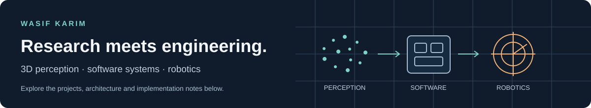

# Wasif Karim

<picture>
  <source media="(max-width: 600px)" srcset="assets/engineering-mobile.svg">
  
</picture>

I work on **AI research engineering, 3D reconstruction and perception**, alongside the software tools and embedded systems that connect them. My background brings together physics and computer science.

**Open to software engineering and robotics opportunities.**

[Portfolio](https://portfoliowasif-murex.vercel.app/) · [Résumé](https://github.com/Wasif-Karim03/Personal_Portfolio/blob/main/public/Resume_WasifKarim.pdf) · [Contact](mailto:mdwasifkarim2003@gmail.com)

## Selected work

### 3D reconstruction & Gaussian tooling

**[GSAV / PLY Editor](https://github.com/Wasif-Karim03/gsav-ply_editor_OC)** — GSPlay and gs-encoder integration for decoding, editing and exporting Gaussian sequences. Includes color/export fixes, regression tests and documented upstream provenance.

[Architecture & setup](https://github.com/Wasif-Karim03/gsav-ply_editor_OC#what-it-does) · [Recorded audit & limitations](https://github.com/Wasif-Karim03/gsav-ply_editor_OC/blob/main/gsplay/docs/audit-2026-09-15.md)

### Robotics & perception

**[Self-Driving Car](https://github.com/Wasif-Karim03/SD_C)** — Jetson RC-car experiments across camera perception, LiDAR, GPS, steering and throttle control. The repository brings together hardware interfaces, calibration tools and an evolving integration workspace.

[Start here](https://github.com/Wasif-Karim03/SD_C#start-here) · [Current workspace](https://github.com/Wasif-Karim03/SD_C/tree/main/final%20updates)

### AI on embedded hardware

**[PhotoCam–ThinkBox](https://github.com/Wasif-Karim03/Photo--cc)** — A Raspberry Pi camera that turns a captured scene into a poem, joke or quote on a thermal printer. Its event-driven pipeline separates hardware interfaces, AI backends and UI, with mock drivers and offline fallback content.

[Architecture](https://github.com/Wasif-Karim03/Photo--cc/blob/main/docs/ARCHITECTURE.md) · [Mock mode & tests](https://github.com/Wasif-Karim03/Photo--cc/blob/main/docs/DEVELOPMENT.md)

## Software engineering

| Project | Engineering focus |
| --- | --- |
| [Claudex](https://github.com/Wasif-Karim03/Claudex_Widget) | Native macOS usage widget; Swift core, log parsing, refresh/backoff behavior and tests. |
| [Mochi Tracker](https://github.com/Wasif-Karim03/Mochi_tracker) | AppKit typing companion; event handling, local aggregate accounting and keyboard animation. |
| [OnlySwap](https://github.com/Wasif-Karim03/OnlySwap) | Campus marketplace in development; TypeScript, Expo, Supabase, database policies and application workflows. |

## Explore further

- **Local vision-language models:** [Poetry Cam](https://github.com/Wasif-Karim03/PoetryCam), a Raspberry Pi/Ollama camera variant with a Flask interface.
- **Embedded systems:** [Terra PetPlant](https://github.com/Wasif-Karim03/terra-petplant), an ESP32S3 plant companion with sensors, display and audio.
- **AI developer tooling:** [Claude × Codex](https://github.com/Wasif-Karim03/Claude-x-Codex), model routing, review stages and run audits.

Each repository documents its own setup, status and limitations. Research prototypes, integrations and product concepts are identified in their project documentation.
