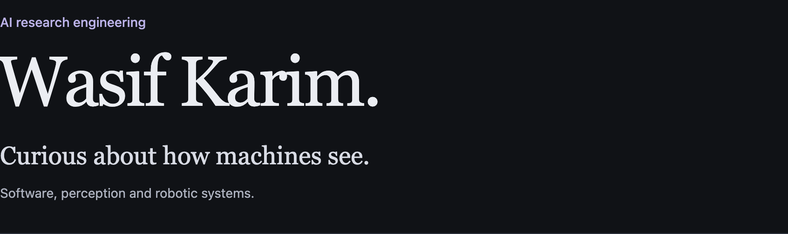
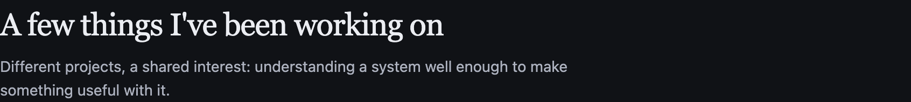
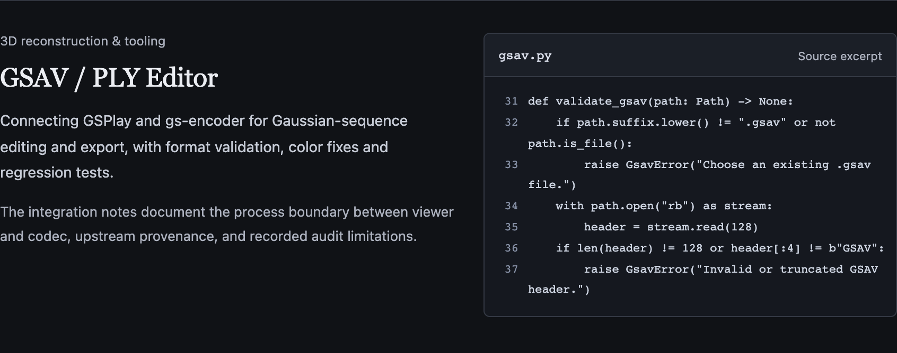
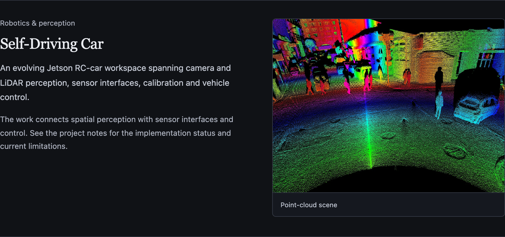
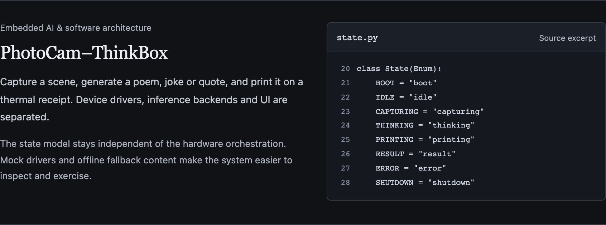

<picture>
  <source media="(max-width: 600px)" srcset="assets/notebook/header-mobile.png">
  
</picture>

I work on **3D reconstruction, perception and AI research engineering**, alongside the software tools and embedded systems that connect them.

[Portfolio](http://www.wasifkarim.com/)  · [LinkedIn](https://www.linkedin.com/in/wasifkarim/) · [Contact](mailto:mdwasifkarim2003@gmail.com)

<picture>
  <source media="(max-width: 600px)" srcset="assets/notebook/intro-mobile.png">
  
</picture>

<picture>
  <source media="(max-width: 600px)" srcset="assets/notebook/gsav-mobile.png">
  
</picture>

[Project & setup](https://github.com/Wasif-Karim03/gsav-ply_editor_OC) · [Integration audit](https://github.com/Wasif-Karim03/gsav-ply_editor_OC/blob/main/gsplay/docs/audit-2026-09-15.md) · [Source](https://github.com/Wasif-Karim03/gsav-ply_editor_OC/blob/main/gsplay/src/infrastructure/gsav.py)

<picture>
  <source media="(max-width: 600px)" srcset="assets/notebook/robotics-mobile.png">
  
</picture>

[Project & hardware notes](https://github.com/Wasif-Karim03/SD_C#start-here) · [Current workspace](https://github.com/Wasif-Karim03/SD_C/tree/main/final%20updates) · [Full point-cloud image](assets/point-cloud-scene.png)

<picture>
  <source media="(max-width: 600px)" srcset="assets/notebook/camera-mobile.png">
  
</picture>

[Project](https://github.com/Wasif-Karim03/Photo--cc) · [Architecture](https://github.com/Wasif-Karim03/Photo--cc/blob/main/docs/ARCHITECTURE.md) · [Mock mode & tests](https://github.com/Wasif-Karim03/Photo--cc/blob/main/docs/DEVELOPMENT.md)

<details>
<summary>Readable project text and source excerpts</summary>

### GSAV / PLY Editor

**3D reconstruction & tooling**

Connecting GSPlay and gs-encoder for Gaussian-sequence editing and export, with format validation, color fixes and regression tests. The integration notes document the process boundary between viewer and codec, upstream provenance, and recorded audit limitations.

[Project & setup](https://github.com/Wasif-Karim03/gsav-ply_editor_OC) · [Integration audit](https://github.com/Wasif-Karim03/gsav-ply_editor_OC/blob/main/gsplay/docs/audit-2026-09-15.md) · [Upstream provenance](https://github.com/Wasif-Karim03/gsav-ply_editor_OC#provenance-and-licensing)

<details>
<summary>Source note: validating an incoming GSAV file</summary>

From [`gsav.py`](https://github.com/Wasif-Karim03/gsav-ply_editor_OC/blob/main/gsplay/src/infrastructure/gsav.py), an exact source excerpt:

```python
def validate_gsav(path: Path) -> None:
    if path.suffix.lower() != ".gsav" or not path.is_file():
        raise GsavError("Choose an existing .gsav file.")
    with path.open("rb") as stream:
        header = stream.read(128)
    if len(header) != 128 or header[:4] != b"GSAV":
        raise GsavError("Invalid or truncated GSAV header.")
```

</details>

### Self-Driving Car

**Robotics & perception**

An evolving Jetson RC-car workspace spanning camera and LiDAR perception, sensor interfaces, calibration and vehicle control. See the project notes for implementation status and current limitations.

[Project & hardware notes](https://github.com/Wasif-Karim03/SD_C#start-here) · [Current workspace](https://github.com/Wasif-Karim03/SD_C/tree/main/final%20updates)

[View the full point-cloud image](assets/point-cloud-scene.png)

### PhotoCam–ThinkBox

**Embedded AI & software architecture**

Capture a scene, generate a poem, joke or quote, and print it on a thermal receipt. Device drivers, inference backends and UI are separated. The state model stays independent of the hardware orchestration; mock drivers and offline fallback content make the system easier to inspect and exercise.

[Project](https://github.com/Wasif-Karim03/Photo--cc) · [Architecture](https://github.com/Wasif-Karim03/Photo--cc/blob/main/docs/ARCHITECTURE.md) · [Mock mode & tests](https://github.com/Wasif-Karim03/Photo--cc/blob/main/docs/DEVELOPMENT.md)

<details>
<summary>Source note: the camera's pipeline states</summary>

From [`state.py`](https://github.com/Wasif-Karim03/Photo--cc/blob/main/photocam/app/state.py), an exact source excerpt:

```python
class State(Enum):
    BOOT = "boot"
    IDLE = "idle"
    CAPTURING = "capturing"
    THINKING = "thinking"
    PRINTING = "printing"
    RESULT = "result"
    ERROR = "error"
    SHUTDOWN = "shutdown"
```

</details>


</details>

## Software engineering

| Project | Engineering focus |
| --- | --- |
| [Claudex](https://github.com/Wasif-Karim03/Claudex_Widget) | Native macOS usage widget; Swift core, session-log parsing, refresh/backoff behavior and tests. |
| [Mochi Tracker](https://github.com/Wasif-Karim03/Mochi_tracker) | AppKit typing companion; event handling, local aggregate accounting and keyboard animation. |
| [OnlySwap](https://github.com/Wasif-Karim03/OnlySwap) | Campus marketplace in development; TypeScript, Expo, Supabase, database policies and application workflows. |

## Explore further

- [Poetry Cam](https://github.com/Wasif-Karim03/PoetryCam): Raspberry Pi/Ollama vision-language camera with a Flask interface.
- [Terra PetPlant](https://github.com/Wasif-Karim03/terra-petplant): ESP32S3 plant companion with sensors, display and audio.
- [Claude × Codex](https://github.com/Wasif-Karim03/Claude-x-Codex): model routing, review stages and run audits.

Each repository documents its own setup, status and limitations.
